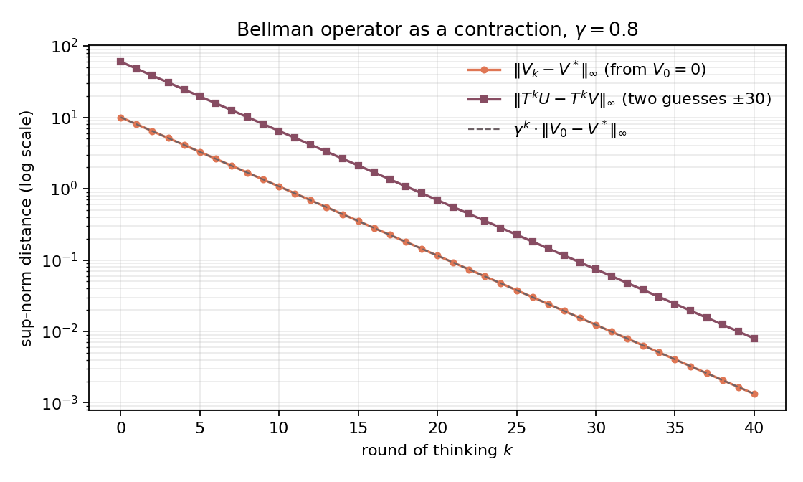

# Robots Aiming for Banach Fixed Points

Why does reinforcement learning work, at least in theory? Because the robot's
thinking rule (the Bellman operator) is a **contraction**, and Banach's fixed-point
theorem, a second-semester theorem, then guarantees a unique true value map and
geometric convergence to it.

This folder contains a small Python implementation that accompanies the
article and interactive demo on
[belindata.com/projects/banach.html](https://belindata.com/projects/banach.html).

## The setup

A robot in a 3×3 room wants to reach its charging station:

```
+-----+-----+-----+
|     |  B  |     |    B = charging station (+2 per tick, absorbing)
+-----+-----+-----+
|     |#####|     |    # = wall
+-----+-----+-----+
|  R  |     |     |    R = robot start
+-----+-----+-----+
```

The robot can move up, right, down or left. Every move costs 1 battery point;
moving into the wall or the edge of the room means staying in place. The
discount factor is γ = 0.8.

The robot's "map" is the value function `V`, one number per cell. Value
iteration improves it with the Bellman operator

$$(TV)(s) = \max_a \big[ R(s,a) + \gamma \, V(s') \big].$$

## Why the error shrinks

Compare the map with the truth `V*` in any cell. Both are computed by the
same formula, so the reward cancels:

$$|(TV)(s) - V^*(s)| \le \gamma \, \max_{s'} |V(s') - V^*(s')|.$$

The error after one round is at most γ times the error before. That is the
contraction property `‖TU − TV‖∞ ≤ γ ‖U − V‖∞`, and Banach's theorem turns it
into a guarantee: exactly one fixed point `V* = TV*`, reached from *any* starting
guess, with `‖V_k − V*‖∞ ≤ γ^k ‖V_0 − V*‖∞`.

## What the script does

`robot_map.py`

1. computes `V*` and the greedy (optimal) policy,
2. runs value iteration from an empty map and prints the error per round
   (10 → 8 → 6.4 → …, ratio exactly 0.8),
3. checks the contraction numerically on 10,000 random pairs of guesses,
4. plots both the error to `V*` and the gap between two very different guesses
   on a log scale, where geometric convergence is a straight line.



## Interactive

`robots_map.html` is the robot demo from the article as a standalone page: open it in any browser.

## Run it

```bash
pip install -r ../requirements.txt
python robot_map.py
```

Requires Python 3.9 or newer.

## Where the guarantee ends

All of this holds in an idealized world: finitely many states, a known model,
and a table of values. Real walking robots learn from noisy experience and
approximate `V` with neural networks. There the projected Bellman operator is in
general no longer a contraction, and Banach alone is not enough.

## Further reading

- Walter Rudin, *Principles of Mathematical Analysis* (3rd ed., 1976), Theorem 9.23:
  the contraction principle as taught in a second-semester analysis course.
- Andrew Ng, *Machine Learning Specialization* (Coursera / DeepLearning.AI),
  where this exploration started.

## License

MIT, see [LICENSE](LICENSE).
